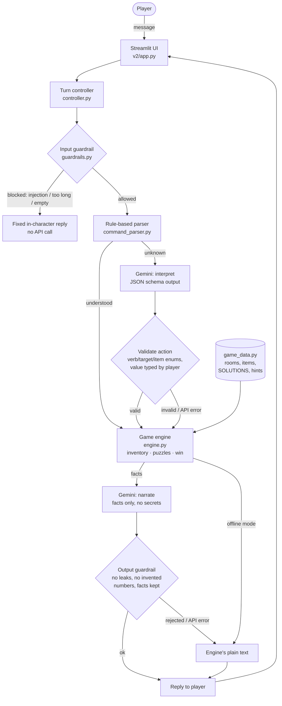

# Version 2 — Game engine + AI narrator + guardrails

Code: [`v2/`](../v2)  ·  Git tag: `v2.0`

## Key idea

**Python owns the rules, Gemini owns the words.**
In V1 the model was both the storyteller and the referee. In V2 a deterministic
game engine is the single source of truth for the inventory, puzzle state, answer
checking and the win condition. Gemini only does what language models are good at:
understanding messy natural language and writing atmospheric descriptions. It never
sees the solutions, so it cannot leak them.

## Architecture

| Component | File | Responsibility |
|---|---|---|
| Streamlit UI | `v2/app.py` | Chat, quick-action buttons, sidebar with inventory/progress/mode, optional debug view per turn |
| Turn controller | `v2/controller.py` | Runs the pipeline above and records which path each turn took |
| Game data | `v2/game_data.py` | Room content, puzzle **solutions**, tiered hints, limits — never sent to the LLM |
| Game engine | `v2/engine.py` | State machine: inventory, flags, answer checking, keypad lockout, hints, win condition |
| Rule parser | `v2/command_parser.py` | Understands common commands without an API call; offline mode and fallback |
| Gemini layer | `v2/ai.py` | `interpret()` → structured JSON action; `narrate()` → prose. Timeout, retries, validation |
| Guardrails | `v2/guardrails.py` | Input checks (length, control chars, prompt injection) and narration checks |

## What changed from V1, and why

| V1 problem | V2 change | Why it fixes it |
|---|---|---|
| Solutions in the prompt could be leaked | Solutions moved to `game_data.py`; Gemini never receives them. Output guard also rejects narration containing an unearned secret. | The model cannot reveal what it was never told. |
| Wrong answers / skipped puzzles accepted | Engine checks answers in code (normalised: `"A Bottle!"` = `bottle`, but `1888` ≠ `1887`). Doors open only through engine rules. | Correctness no longer depends on the model's mood. |
| Inventory only existed in chat text | `GameState` dataclass holds inventory and flags; `use` requires the item to be in the inventory. | "I already have the keycard" changes nothing. |
| Win detected by searching for `[ESCAPED]` | `state.escaped` is set only by the engine when the keycard is used on the door. `[ESCAPED]` in input is blocked. | The win condition cannot be forged. |
| Crashed on API errors / missing key | 15 s timeout, 2 retries with back-off, fallback to rule parser + engine text, automatic **offline mode** without a key. | The game is always playable. |
| History resent every turn (growing cost) | Each Gemini call gets only the current message and facts (constant size). Common commands are parsed by rules — no API call at all. | Cost and latency stay flat. |
| No input validation | Max 300 chars, control characters stripped, unicode normalised, injection patterns blocked before any API call. | Abuse is stopped early and cheaply. |
| LLM could invent a code/answer for the player | Gemini's JSON is validated against enums; a `value` must literally appear in the player's message. | The model can't solve puzzles on the player's behalf. |
| Not testable | Logic is plain Python: 49 pytest tests, Gemini replaced by fakes. | Behaviour is verifiable and repeatable. |

New gameplay features: tiered hints that follow the player's progress, a keypad that
jams for 3 moves after 5 wrong codes (stops brute force), a moves/hints counter,
quick-action buttons and a debug toggle showing how each turn was handled.

## Design decisions

- **Rules first, Gemini second for intent.** Most commands ("examine clock") are
  understood by the rule parser instantly and for free. Gemini is called only for
  phrasing the rules don't understand. This is cheaper, faster and more predictable.
- **Gemini always narrates when online.** This is where the "AI" adds the most:
  every response is atmospheric, but the facts underneath come from the engine.
- **Defense in depth.** The injection filter is a simple heuristic and *can* be
  bypassed with clever wording (see TC2 in [test cases](test_cases.md)). That is
  acceptable because two more layers follow: the model has no secrets, and the
  output guard checks what it writes.

## Limitations

- One room and fixed puzzles; content is hand-written in `game_data.py`.
- The output guard can reject a perfectly good narration (e.g. if Gemini paraphrases
  a required word). The player then sees the plain engine text — correct, just less
  atmospheric.
- The injection pattern list is English-only and heuristic.
- Game state lives in the Streamlit session; refreshing the browser restarts the game.
